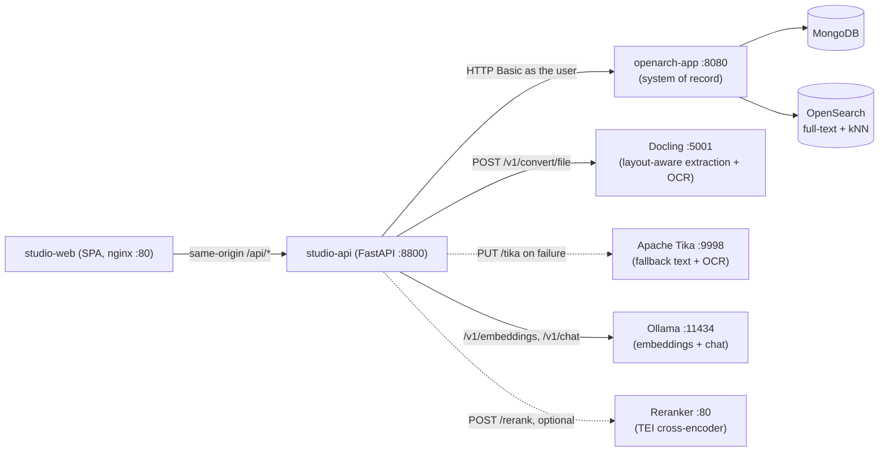
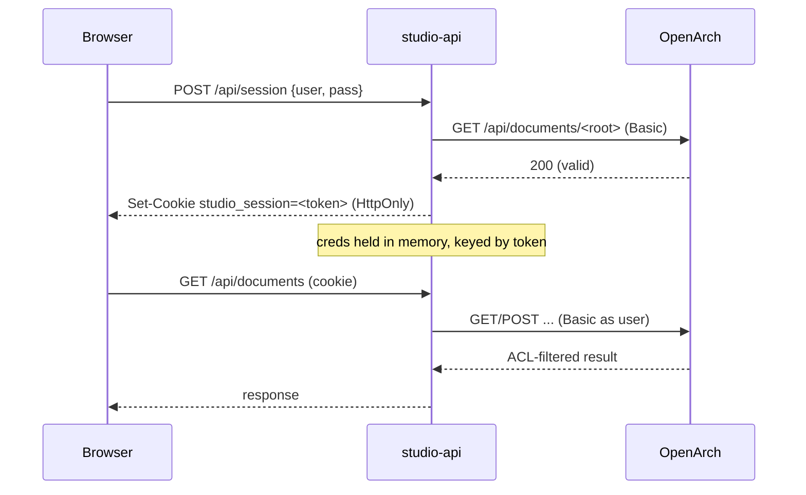
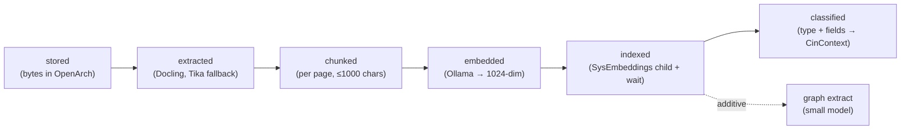
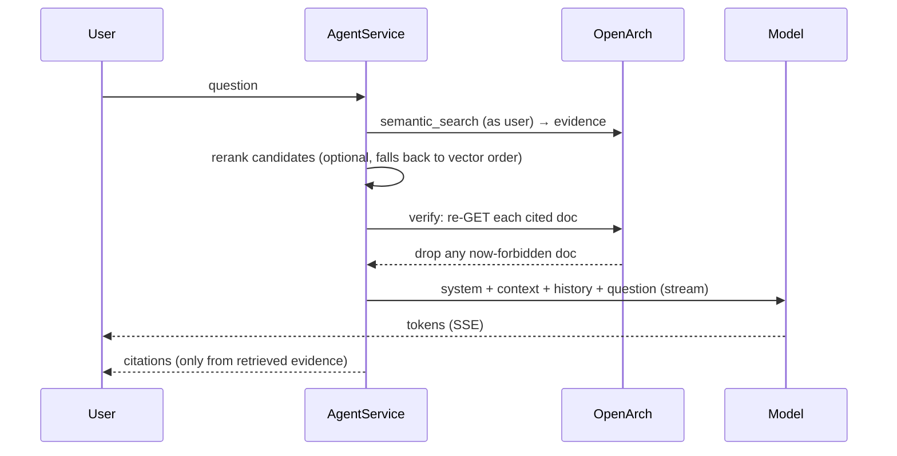

# OpenArch Studio — Technical Deep Dive

A companion POC that overlays a working UI and an AI pipeline on top of
[OpenArch](../../README.md), the open-source AI-ready content platform. Studio
is deliberately a *thin extension*: OpenArch stays the system of record for
documents, permissions, and vectors, and every AI capability Studio adds runs
**as the signed-in user** so OpenArch ACLs are never bypassed.

The guiding principle throughout: **make it obvious which behavior is native
OpenArch and which is a Studio extension.** That separation is enforced in code
(the capability ledger) and visible in the UI.

---

## 1. System architecture



| Service | Image / build | Role |
|---|---|---|
| `studio-web` | `./web` (nginx) | React SPA, served on `${STUDIO_PORT:-8900}` → container `:80`. Proxies `/api/*` to the API. |
| `studio-api` | `./api` (FastAPI/uvicorn `:8800`) | Backend-for-frontend: session gateway, enrichment, search, RAG, graph. |
| `openarch-app` | included from [`../../docker-compose.yml`](../../docker-compose.yml) | Documents, ACLs, HXQL + vector query. |
| `docling` | `quay.io/docling-project/docling-serve-cpu:v1.38.2` | Primary extraction: layout-aware Markdown, tables, and OCR. Not published to the host. |
| `tika` | `apache/tika:2.9.2.1-full` | Fallback extraction and **Tesseract OCR** of scanned images. |
| `ollama` | `ollama/ollama:latest` | Local OpenAI-compatible embeddings and chat. |
| `reranker` | `ghcr.io/huggingface/text-embeddings-inference:cpu-arm64-1.9` (`${STUDIO_RERANKER_IMAGE}`) | Cross-encoder reranking (`BAAI/bge-reranker-base`). Optional; weights cached in the `reranker-models` volume. |

The Studio stack `include:`s the OpenArch base compose file, so one
`docker compose up` brings up the whole thing. See
[`compose.yaml`](../compose.yaml).

---

## 2. Identity and the permission model

This is the most important design decision in the project.

- **Session gateway.** The browser never holds OpenArch credentials. On sign-in,
  [`auth.py`](../api/app/auth.py) validates the username/password against
  OpenArch (`GET /api/documents/<root>`) and, on success, stores the credentials
  **in server memory only**, keyed by an opaque session token returned as an
  `HttpOnly` cookie (`studio_session`, TTL `session_ttl_seconds`, default 1h).
- **Every call is the user's call.** [`OpenArchClient`](../api/app/openarch.py)
  wraps exactly one caller's credentials and sends HTTP Basic on every request.
  There is no service account and no elevation. Retrieval, search, graph
  reads — all run as that user, so OpenArch's ACL engine is the single
  authority.
- **Typed failures.** Transport/status errors map to
  `OpenArchAuthError` / `OpenArchForbidden` / `OpenArchNotFound` /
  `OpenArchUnavailable`, which the route layer translates to 401/403/404/503.



---

## 3. Data model inside OpenArch

Studio stores its AI artifacts **as native OpenArch documents**, not in a side
database. This is what lets deletion, ACLs, and scoping "just work."

- **Source file** — a `SysFile` holding the original bytes in `sysfile_blob`.
- **Embeddings** — one `SysEmbeddings` child document per source file, named
  `_e_<embedding-type>`, carrying a Parquet blob in `sysemb_embeddings`. The
  parent first gains the `SysHasEmbeddings` mixin
  (`ensure_has_embeddings_mixin`).
- **Extracted fields** — the native `CinContext` mixin on the source file (see §4,
  step 6).
- **Folders** — native `SysFolder`; hierarchy via `sys_parentId` and the
  `sys_ancestorIds` array (used for subtree scoping, see §7).

### Parquet schema

The embeddings blob must match OpenArch's `embedding.avsc`. Studio mirrors it in
[`parquet.py`](../api/app/parquet.py):

| Field | Type | Notes |
|---|---|---|
| `id` | string | deterministic `uuid5` per chunk |
| `type` | string | sanitized embedding-model label |
| `vector` | list<float64> | **padded to exactly 1024** |
| `text` | string | chunk text |
| `blobref` | string? | null |
| `location` | struct{text{page,paragraph}} | chunk provenance |

> **Vector width gotcha.** OpenArch's `EmbeddingModel.VECTOR_SIZE = 1024` pads
> stored vectors to 1024 and rejects longer ones. `normalize_vector()` pads to
> 1024 and is applied to **both stored chunk vectors and query vectors**, so the
> dimensions always agree at search time. A query embedded at the model's native
> width (e.g. 768) is zero-padded identically.

---

## 4. Enrichment pipeline

[`enrichment.py`](../api/app/enrichment.py) turns an uploaded binary into
searchable, AI-ready artifacts. It runs as a FastAPI background task and reports
progress through six stages (`classified` is additive, see step 6).



1. **stored** — the source `SysFile` already holds the bytes; the pipeline
   re-reads them from OpenArch so a retry needs nothing cached in Studio.
2. **extracted** — [`extraction.py`](../api/app/extraction.py) defines an
   `Extractor` seam returning Markdown, one string per page, and the engine
   name. `DoclingExtractor` posts the original bytes to docling-serve
   (`POST /v1/convert/file`, Markdown output, OCR on) with a page-break
   placeholder so pages can be recovered. `TikaExtractor` is the older
   `PUT {tika}/tika` path and returns a single page. `FallbackExtractor` tries
   Docling and, on `ExtractionFailed` (HTTP error, `failure`/`skipped` status,
   empty text), falls back to Tika. `STUDIO_EXTRACTOR=tika` skips Docling.
   The Activity stage detail reads `Docling · n chars`, `Tika fallback · n chars`
   or `Tika · n chars`. The Docling timeout is `STUDIO_DOCLING_TIMEOUT_SECONDS`
   (default **300 s**); OCR of large multi-page scans is slow.
3. **chunked** — `chunk_pages()` works page by page: each page is split on
   headings and blank lines, so a paragraph, list or table is one block. A table
   stays whole when it fits, otherwise it is split on row boundaries; other blocks are
   hard-wrapped at 1000 chars. The nearest
   preceding heading is prefixed to each chunk for context. Chunk ids are
   deterministic (`uuid5`) so the same text always yields the same ids, and the
   real page number is stored in the SysEmbeddings `location.text.page`.
4. **embedded** — one batched call to `/v1/embeddings`; each vector normalized
   to 1024.
5. **indexed** — write the Parquet, `ensure_has_embeddings_mixin`, upload the
   blob, create the `SysEmbeddings` child, then
   `waitForFullTextSearchIndexing`.

6. **classified** — [`fields.py`](../api/app/fields.py) makes one JSON-mode call
   to `STUDIO_EXTRACT_MODEL` (default `llama3.2:3b`) over the first 6,000
   characters of the Markdown and returns `{type, fields}`.
   - **Vocabulary.** Before the call, `FieldsService.vocabulary` runs an HXQL
     query **as the caller** over the 200 most recently modified documents with
     the `CinContext` mixin and builds `{type: [field names]}`, so the model
     can reuse existing types and names. Only names are read, never values, and
     only from documents the caller can read. Names are sanitized before they
     reach the prompt: only names already in normalized form, at most 25 per
     type and 50 types.
   - **Normalization.** Type and field names become ASCII `snake_case` (≤ 64
     chars); at most 25 fields; strings are cut at 500 chars; dates in
     `%Y-%m-%d`, `%d.%m.%Y`, `%m/%d/%Y` or `%Y/%m/%d` become ISO 8601; money
     strings become numbers, but identifier-like strings (leading zeros,
     non-thousands space groups, more than 15 digits) stay strings; non-finite
     numbers are dropped.
   - **Storage.** `store` adds the `CinContext` mixin and writes
     `cinctx_contextProperties` = `{"document_type": …, …fields}` (a flat map,
     replaced on each run) and `cinctx_contextPropertyNames` (its keys).
     Written as the signed-in user.
   - **HXQL findings** (verified live): REST accepts the free-form map, and
     HXQL filters on its keys with the dot or slash path form, e.g.
     `SELECT * FROM SysContent WHERE cinctx_contextProperties.total > 1000`.
     The `:` path form does not work. String equality on keys and
     `cinctx_contextPropertyNames = 'total'` also work.
   - **Failure behavior.** A failure (`no write permission on this document`,
     `model returned invalid JSON`, a model/HTTP error) marks only the
     `classified` stage `failed`; the job stays `complete` and the document
     stays searchable. Activity offers Retry when any stage failed. The stage
     detail reads `{type} · {n} fields`. Baseline mode hides the Extracted
     fields panel and the Library type chips.

After indexing succeeds, graph extraction runs **additively** (a failure there
never fails the enrichment job).

### Concurrency

OCR (Docling/Tika) and embedding (Ollama, CPU) are the bottlenecks. A batch upload of
many files would otherwise flood them and produce read timeouts, so the service
holds an `asyncio.Semaphore(enrich_concurrency)` (default **2**) around the whole
per-document pipeline.

### Durable vs. transient state

Job history lives in an in-memory `JobStore` and is lost on restart — but that's
fine: **readiness is reconstructed from OpenArch** (the `SysHasEmbeddings` mixin
and the `SysEmbeddings` children). The durable truth is always in the system of
record.

---

## 5. Search — three modes, one surface

[`search.py`](../api/app/search.py) exposes `POST /api/search` with
`mode ∈ {keyword, hxql, semantic}`. Every response carries a `provenance` block
naming which layer did what and how long it took.

| Mode | Path | Who does what |
|---|---|---|
| `keyword` | `/api/query/embeddings` | Studio embeds the query, OpenArch kNN retrieves, then Studio keeps only chunks whose text actually contains the term(s). |
| `hxql` | `/api/query` | Raw HXQL straight to OpenArch — no Studio layer. |
| `semantic` | `/api/query/embeddings` | Studio embeds the query; OpenArch vector search ranks. |

> **Why keyword rides the embedding index.** In this deployment OpenArch's
> server-side `sys_fulltext` isn't populated, but Studio's chunk text *is* in the
> embeddings index. So keyword search retrieves candidates by vector and filters
> them down to literal term matches — a pragmatic workaround that keeps keyword
> search useful without depending on server-side full-text.

`embeddingType` is passed as a wildcard (`<type>*`) so a query matches whatever
embedding model variant produced the stored vectors.

### Reranking

[`rerank.py`](../api/app/rerank.py) reorders candidates with a cross-encoder served by
Hugging Face text-embeddings-inference (`POST {STUDIO_RERANKER_URL}/rerank`).
Semantic search, keyword search and chat retrieval use it; HXQL does not.

- **Candidates.** Semantic search asks OpenArch's ACL-filtered kNN for
  `max(top_k, min(top_k * 2, 12))` hits, reranks them, and keeps `top_k`. Ask uses
  the same count only when a reranker is configured; otherwise it uses `top_k`.
  Keyword search fetches 50 chunk hits, keeps those containing the query terms,
  and reranks the first `max(limit, 12)` of them. Reranking only reorders what the
  caller was already permitted to read.
- **Truncation.** Each text is cut to 512 characters before it is sent.
- **Fallback.** `STUDIO_RERANKER_URL` empty, a 5 s timeout, a non-2xx response, an
  unreachable service, or a malformed response keeps vector order. The search
  provenance and the chat `TOOL_CALL_END` event carry `rerank: reranked` or
  `rerank: skipped (not configured | timeout | HTTP <code> | unreachable | incomplete response)`,
  and the UI shows it.
- **Scores.** Results and citations carry `score` (the rerank score when reranked)
  and `vectorScore` (OpenArch's kNN score); the UI shows both on citations.
- **Why `bge-reranker-base`, and why 12 candidates.** The first choice,
  `BAAI/bge-reranker-v2-m3`, was OOM-killed at TEI's default batch size and took
  56 s for 30 candidates on Docker CPU. `BAAI/bge-reranker-base` with
  `--max-batch-tokens 4096` and the smaller candidate set are chosen to stay within
  the 5 s timeout on Docker CPU (from a local benchmark). Larger models are a `STUDIO_RERANK_MODEL` change if you have the
  hardware.

---

## 6. RAG agent and streaming chat

[`agent.py`](../api/app/agent.py) + [`chat.py`](../api/app/chat.py) implement
grounded, cited Q&A over SSE (`POST /api/chat`, events:
`retrieval → token* → citations → done` / `error`).



Security properties baked in:

- **Retrieve-then-verify.** Evidence is ACL-filtered at retrieval (it runs as the
  user), and then **each cited document is re-fetched** before answering. An
  access change between retrieval and citation cannot leak cached text.
- **Untrusted context.** The system prompt tells the model the context is
  untrusted data and to never follow instructions inside it — a prompt-injection
  guard, since the corpus is OCR'd third-party documents.
- **No fabricated citations.** Studio only emits citations drawn from the
  evidence it actually retrieved; with no evidence it returns a fixed
  "not enough information" answer instead of hallucinating.
- **Page-aware citations.** Each chunk's page comes from the stored
  `location.text.page`, so chat, keyword/semantic search and A2UI sources all
  carry a `page`. Clicking a citation opens `/documents/{id}?page=N`; PDFs open
  at `#page=N` in the browser's native viewer. Sources from the Tika path have
  a single page.

---

## 7. Folder scoping (siloing)

Users can create folders and **scope** Search / Ask / Graph to a subtree, so a
RAG session or graph can be kept to one project's documents.

The mechanism is a single native field: **`sys_ancestorIds`**, the array of every
ancestor id, which OpenArch itself maintains (and uses in its own ACL
denormalizer). When a scope (folder id) is active, Studio appends
`WHERE sys_ancestorIds = '<folderId>'` to the query:

- Search / Agent: `_scoped_query(scope)` and the agent's retrieval query.
- Graph: `GraphService.merged(credentials, scope)` keeps only docs whose
  `sys_ancestorIds` contains the scope.

Scope ids are regex-sanitized (`[^A-Za-z0-9-]` stripped) before interpolation.

Verified live: unscoped semantic search returned 7 docs; scoped to a new
"Contracts Q3" folder it returned exactly the 1 document placed there, and the
scoped graph showed only that document's entities.

---

## 8. Knowledge graph

[`graph.py`](../api/app/graph.py) extracts a typed entity/relation graph from
each enriched document using the **extract model** (`STUDIO_EXTRACT_MODEL`,
`llama3.2:3b` by default).

- **Ontology:** `Person, Organization, Location, Policy, Concept, Role, Date`.
  The extractor is constrained to these types and ≤20 entities per doc.
- **Defensive parsing:** `parse_graph()` tolerates code fences and prose, pulls
  the JSON object, and drops entities with an out-of-ontology type.
- **Lenient relation resolution:** `_resolve()` matches relation endpoints to
  entities even when the model shortens/expands a name ("Acme" vs
  "Acme Corporation").
- **Noise filter:** `_is_noise()` drops OCR fragments (labels with <3 letters —
  amounts, invoice numbers).
- **Co-occurrence edges:** per document, entities are linked to a hub (preferring
  an `Organization`) with an inferred `appears with` edge, so the graph clusters
  per document instead of floating as disconnected points.
- **Permission + scope:** `merged()` only includes documents the caller can read,
  and (optionally) only those under a scope folder.

Persistence: graphs are stored per-doc in a `GraphStore`, serialized to
`graph_store_path` (`/data/graph.json`, on the `studio-data` volume) via
atomic replace, so the graph survives API rebuilds.

---

## 9. Deletion propagation

`DELETE /api/documents/{id}` deletes the document in OpenArch **and** evicts it
from the graph store. Because embeddings are `SysEmbeddings` *children* of the
source document, OpenArch removes them with the parent — so retrieval and search
stop returning the doc automatically. No separate index cleanup is needed.

Verified live: deleting a document took the library from 12 → 11, its chunks
from search 3 → 0, and left 0 references in the graph.

---

## 10. Capability attribution (native vs. extension)

[`capabilities.py`](../api/app/capabilities.py) serves a strict ledger the UI
renders, and a test proves native capabilities are never attributed to
Studio/Docling/Tika/Ollama and extensions never claim native status.

- **Native (OpenArch):** storage, folders & hierarchy, deletion, metadata/content
  models, ACLs & effective permissions, HXQL queries, `SysEmbeddings` vector
  search, users/groups/vocabularies, permission-aware retrieval, OpenSearch
  indexing.
- **Extensions (Studio / Studio + Docling (Tika fallback) / Studio+model):** visual workspace, OCR,
  inline viewer, text/metadata extraction, chunking & embedding, embeddings
  inspection, guided search, reranking, RAG + streaming chat, graph extraction &
  visualization, citations & retrieval trace, deletion reflected in Q&A & graph,
  the session gateway.

---

## 11. Frontend

React + TypeScript SPA (Vite), served by nginx which proxies `/api/*` to the API.

- **Routing / shell:** `app.tsx` restores the session, wraps everything in a
  `ScopeProvider`, and renders an `AppShell` with left-rail nav.
- **Scope context:** `scope.tsx` holds the active folder; a `ScopeBanner` appears
  on Search / Ask / Graph when a scope is set.
- **Pages:** Login, Library (breadcrumb browse, new folder, scope button,
  folder-targeted upload), Search (3 modes + provenance), Ask (streaming chat +
  citations + retrieval trace), Document (tabs: metadata / permissions / content
  viewer / embeddings / raw, plus delete), Activity (enrichment jobs), Graph
  (force-directed, degree sizing, label declutter, inferred edges), Capabilities.
- **Viewer:** images/PDFs render inline; **TIFF/BMP are converted to PNG** by a
  Pillow-backed `/preview` endpoint since browsers can't render TIFF.

---

## 12. Configuration

All settings are `STUDIO_`-prefixed env vars with Compose-friendly defaults
([`config.py`](../api/app/config.py)):

| Setting | Default | Purpose |
|---|---|---|
| `STUDIO_OPENARCH_URL` | `http://openarch-app:8080` | system of record |
| `STUDIO_TIKA_URL` | `http://tika:9998` | fallback extraction / OCR |
| `STUDIO_EXTRACTOR` | `docling` | `docling` (Tika fallback) or `tika` only |
| `STUDIO_DOCLING_URL` | `http://docling:5001` | docling-serve |
| `STUDIO_DOCLING_TIMEOUT_SECONDS` | `300` | per-document Docling timeout |
| `STUDIO_MODEL_BASE_URL` | `http://ollama:11434/v1` | OpenAI-compatible models |
| `STUDIO_EMBEDDING_MODEL` | `nomic-embed-text` | chunk + query embeddings |
| `STUDIO_CHAT_MODEL` | `llama3.2:3b` | RAG answers (chat role) |
| `STUDIO_EXTRACT_MODEL` | `llama3.2:3b` | graph, document classification + field extraction (extract role); `STUDIO_GRAPH_MODEL` is a deprecated alias, used only when this is unset |
| `STUDIO_RERANK_MODEL` | `BAAI/bge-reranker-base` | cross-encoder the `reranker` service loads (rerank role) |
| `STUDIO_RERANKER_URL` | `http://reranker:80` (Compose default; API default empty = off) | reranker endpoint; empty disables reranking |
| `STUDIO_RERANKER_IMAGE` | `…text-embeddings-inference:cpu-arm64-1.9` | Compose-only; `…:cpu-1.9` on x86_64 |
| `enrich_concurrency` | `2` | max concurrent enrichments |
| `STUDIO_GRAPH_STORE_PATH` | `/data/graph.json` | persisted graph |
| `session_ttl_seconds` | `3600` | in-memory session lifetime |

### Model roles and warm-up

Four roles, one setting each: **embed** (`STUDIO_EMBEDDING_MODEL`), **extract**
(`STUDIO_EXTRACT_MODEL`: graph, classification, fields), **chat**
(`STUDIO_CHAT_MODEL`) and **rerank** (`STUDIO_RERANK_MODEL`, set on the reranker
container). The three LLM roles share `STUDIO_MODEL_BASE_URL`. Chat defaults to
`llama3.2:3b` because `llama3.1` 8B was unusably slow on CPU
(see [studio-issues/02](../studio-issues/02-default-chat-model-too-heavy.md)); it
remains a valid `STUDIO_CHAT_MODEL` on GPU hosts.

[`warmup.py`](../api/app/warmup.py) sends one 1-token request to the extract and
chat models in a background task at startup, so the first graph build or answer
isn't cold (see
[studio-issues/01](../studio-issues/01-graph-auto-extraction-reliability.md)).
Failures are logged and never block startup.

### Run

```shell
cd pocs/openarch-studio
cp .env.example .env
export OPENARCH_VERSION=1.0.0
docker compose up -d --build
# one-time model pulls:
docker compose exec ollama ollama pull nomic-embed-text
docker compose exec ollama ollama pull llama3.2:3b
```

On x86_64 hosts set `STUDIO_RERANKER_IMAGE=ghcr.io/huggingface/text-embeddings-inference:cpu-1.9`
in `.env`. The reranker downloads its model on first start.

Open `http://localhost:8900`, sign in with OpenArch credentials
(`admin` / `password` on a default repo).

---

## 13. Testing

- **API:** `cd api && .venv/bin/pytest -q` (256 passing) — covers the Parquet
  schema/normalization, search modes, agent retrieve/verify, capability
  attribution invariants, graph parsing/merge/scope, and deletion.
- **Web:** `cd web && npx vitest run` (28 passing) and `npx tsc -b --noEmit`.

---

## 14. Known limitations & upstream findings

- **OCR language coverage** has not been verified for non-Latin or less common scripts; test
  representative scans before relying on them.
- **Keyword search** depends on the embedding index rather than server-side
  `sys_fulltext` in this deployment (see §5).
- **Build-from-source.** The public OpenArch image is gated, so the POC builds
  OpenArch locally; two upstream issue drafts
  ([build without `.git`](../upstream-issues/01-build-without-git.md),
  [dev Dockerfile](../upstream-issues/02-dev-dockerfile.md)) capture the friction.
  More context in [`UPSTREAM-FINDINGS.md`](../UPSTREAM-FINDINGS.md).

---

*Studio is a POC. It optimizes for making OpenArch's AI-readiness legible and
demonstrable, not for production hardening.*
